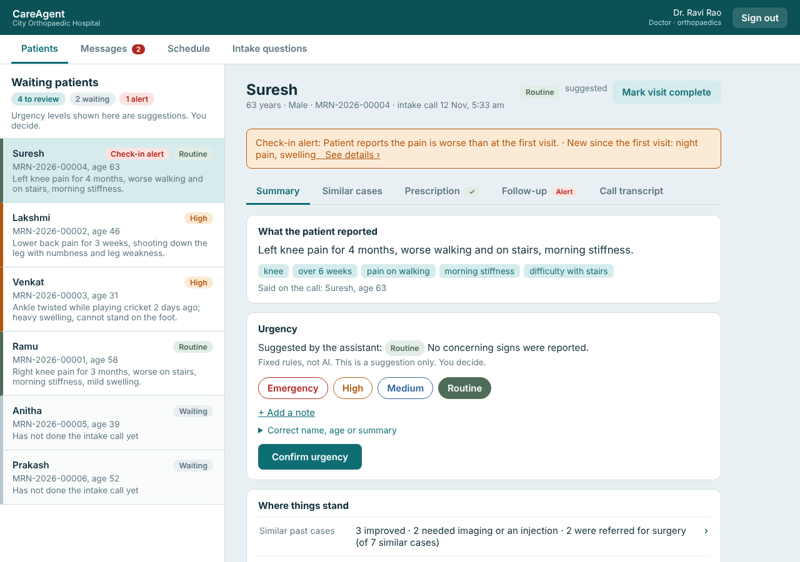
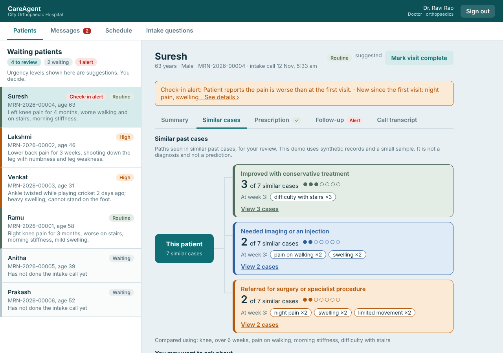
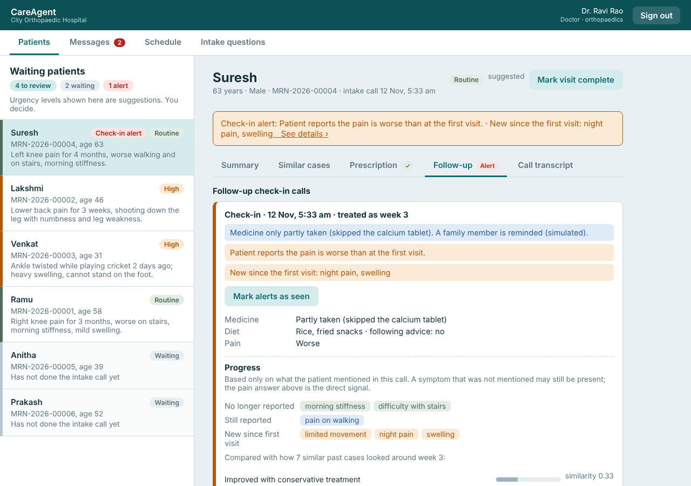
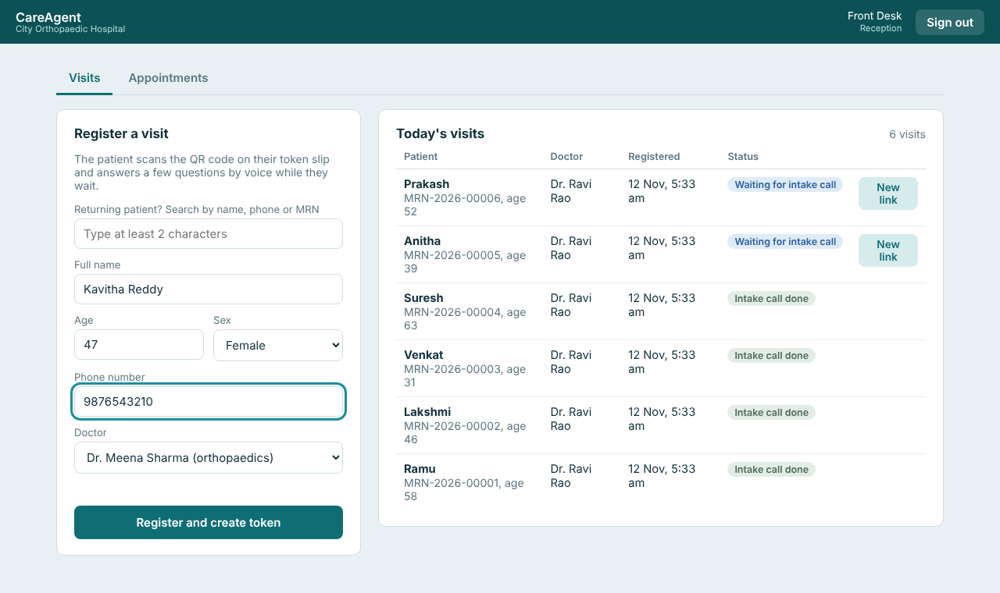
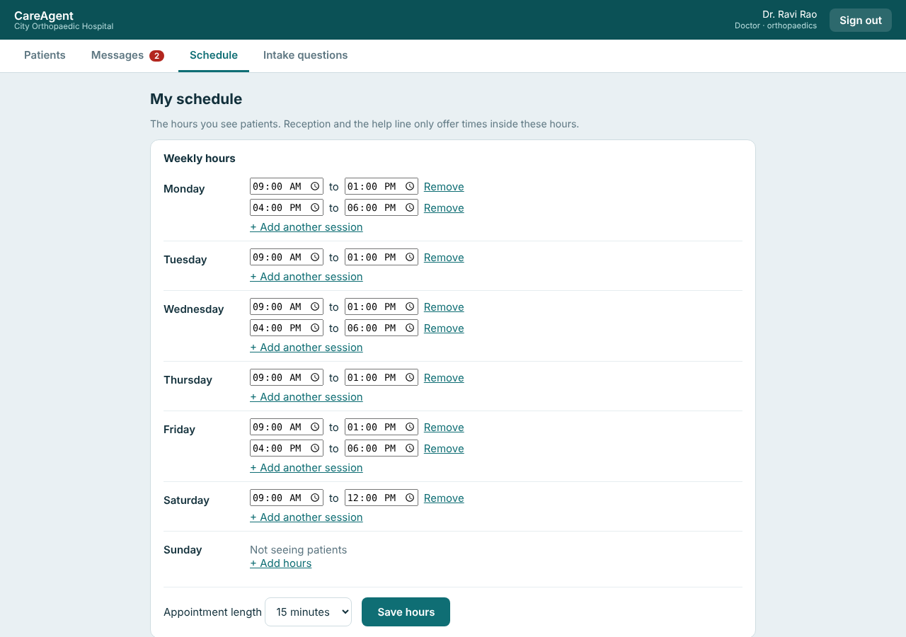
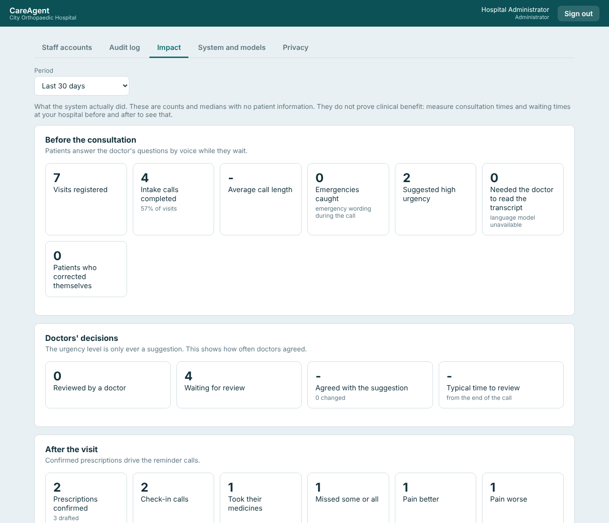
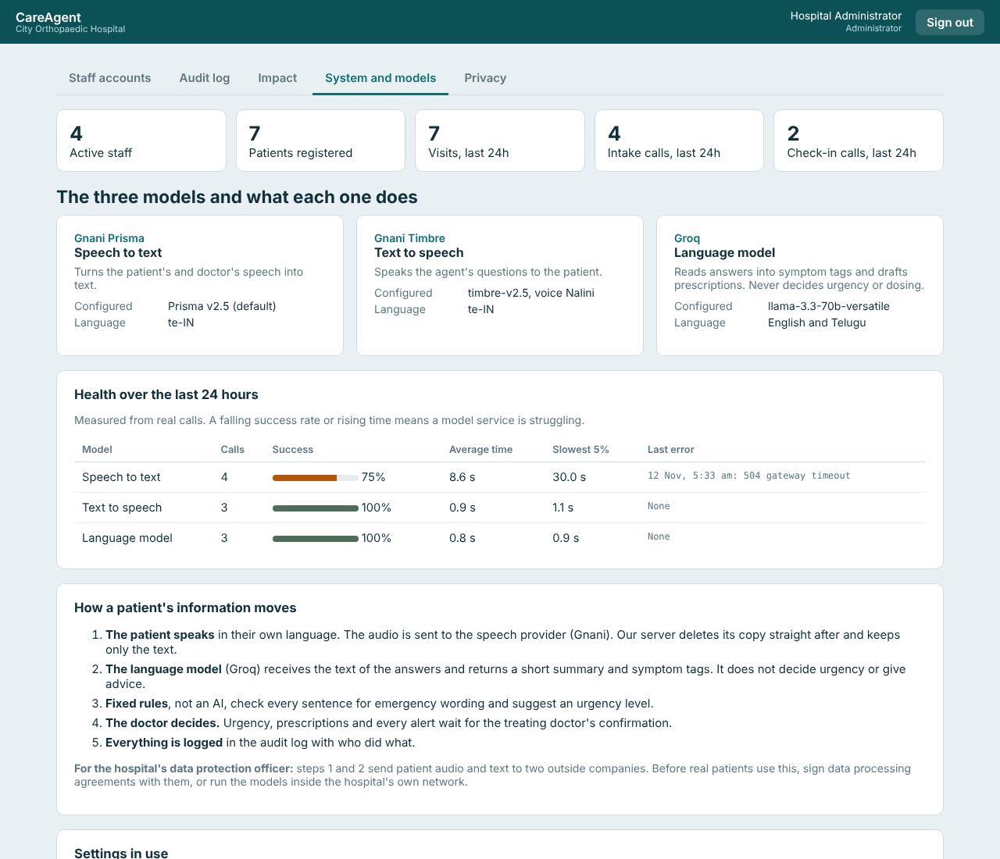

# CareAgent

**A voice assistant that lets patients talk to their hospital in their own language, and keeps the doctor in charge.**

Patients answer a doctor's questions by speaking while they wait. The doctor walks in already informed. After the visit the
same assistant reminds the patient about medicines and diet, answers questions from the doctor's own record, books
appointments, and tells the doctor early if something is going wrong. Everything runs over ordinary speech, so patients need
no app, no smartphone skills and no typing.

> Built for the **Great Indian AI Internship Challenge** on Gnani.ai's speech models (Prisma speech-to-text and Timbre
> text-to-speech). First language: **Telugu**.
>
> **Not a medical device.** Urgency levels, similar cases and drafts are suggestions for a clinician. All demo data is synthetic.



## The problem

In many Indian hospitals, and especially for rural and elderly patients, three things go wrong again and again:

- **Long waits that produce nothing.** Patients sit for hours, then get a few minutes with the doctor, much of it spent on routine history-taking.
- **Instructions forgotten.** Medicines get missed and diet advice is not followed, and nobody finds out until the next visit.
- **No one to ask.** A patient with a simple question phones the hospital and cannot get through, or does not ask at all.

## What it does

1. **Reception registers the patient** and prints a slip with a QR code and a private help-line PIN.
2. **Pre-visit call.** The patient scans the QR code and answers the doctor's own questions by voice. Emergency wording ends the call at once and alerts staff.
3. **The doctor sees a summary**: what the patient reported, symptom tags, a *suggested* urgency with the reason, and how similar past cases progressed. The doctor decides.
4. **Consultation and prescription.** The doctor records the consultation (with the patient's consent) or pastes a transcript. A draft prescription appears; the doctor edits and confirms it.
5. **Reminder calls** use only the confirmed prescription. They ask about medicines, diet, pain and new symptoms. Missed medicine, worse pain or new warning signs alert the doctor, with progress compared against similar cases.
6. **Help line.** The patient phones in with their number and PIN. The assistant answers from the doctor's confirmed record, books appointments from the doctor's real timetable, and passes anything else to the doctor. If nobody answers in time, it moves up to the doctor's supervisor.

## Screenshots

| Similar past cases | Follow-up alerts |
|---|---|
|  |  |
| **Reception** | **Doctor's schedule** |
|  |  |
| **What the system did (no patient data)** | **How the models are performing** |
|  |  |

## Who uses what

| Person | Page | Can do | Cannot do |
|---|---|---|---|
| **Reception** | `/frontdesk` | Register visits, print QR and PIN slips, see who has done the intake call, book appointments, see emergency calls with the number to ring | See anything clinical |
| **Doctor** | `/doctor` | See only *their own* patients; intake summary, similar cases, prescriptions, follow-up alerts; messages from the help line; own timetable; own intake questions | Open another doctor's patient |
| **Administrator** | `/admin` | Staff accounts and supervisors, audit log, aggregate impact numbers, model health, erase a patient's data | Read any patient record |
| **Patient** | `/call?t=...` and `/helpline` | Answer a call from a private single-use link, or phone the help line with number and PIN | Anything else. Patients have no accounts |

## How the AI is used

| Model | Provider | Job | It never |
|---|---|---|---|
| Speech to text | Gnani Prisma | Turns speech into text | |
| Text to speech | Gnani Timbre | Speaks the assistant's questions and answers | |
| Language model | Groq (`llama-3.3-70b-versatile` by default) | Turns answers into a short summary and symptom tags; drafts a prescription from a transcript; decides *what category* a caller's question is | Decides urgency, gives advice, chooses a dose, or writes the answer to a medical question |

The principles that make it safe to put in front of patients:

- **Emergency detection and the urgency suggestion are plain, visible rules, not AI.** The reasons are shown to the doctor.
- **Answers are read, never written.** The help line builds its reply from the doctor-confirmed prescription with fixed Telugu templates, so a dose is spoken exactly as the doctor wrote it. A medicine that was never prescribed gets no answer; the question goes to the doctor.
- **The doctor decides.** Urgency, prescriptions and every alert wait for the treating doctor.
- **Unexpected model output is never trusted.** Unknown categories, symptom tags or answer ids are ignored, and when the language model is down the call still works and the doctor is told to read the transcript.
- **Similar-case matching is counting, not prediction.** It shows counts ("2 of 7 similar cases..."), warns when there are too few cases, and never shows a percentage or a risk score.

## Features

**Patient calls**
- Pre-visit intake in Telugu with doctor-defined questions, spoken consent, and a final "anything to change or add?" so patients can correct themselves (the latest statement wins and corrections are listed for the doctor)
- Follow-up reminder calls from the confirmed prescription, with medicine, diet, pain and new-symptom checks
- Help line with identity check (phone number + PIN), answers from the record, doctor-approved standard answers, symptom reports, and emergency handling
- Typed-answer fallback if speech recognition is unavailable; automatic retries when the speech service times out

**For doctors**
- Decision-first patient screen: reported symptoms, suggested urgency with reasons, similar cases at a glance, and tabs for detail
- Similar past cases with full de-identified records and a side-by-side comparison with the current patient
- Consultation recording (cut at quiet moments, up to 4 minutes) or pasted transcript, a draft prescription, and digital confirmation
- Messages inbox ordered by urgency, with a hierarchy: unanswered messages move up to the doctor's supervisor
- Own weekly timetable and days off; appointments booked by reception or by phone
- Own intake questions in Telugu and English, with a "Hear it" button to listen exactly as the patient will

**For hospitals**
- Staff accounts with three roles, forced password change on first sign-in, and per-account lock-out
- A full audit trail of who opened, decided or changed what
- Aggregate impact numbers with no patient information, and model health measured from real calls
- A tool to erase a patient's data permanently, keeping only anonymous counts and the consent log
- `python manage.py check`, which finds unsafe settings before go-live

## Quick start

Requires Python 3.10+, a [Gnani](https://gnani.ai) API key and a [Groq](https://groq.com) API key.

```bash
python -m venv venv && source venv/bin/activate        # Windows: venv\Scripts\activate
pip install -r requirements.txt
cp .env.example .env                                   # add your two API keys
python manage.py create-user                           # creates the first administrator (asks for a password)
uvicorn app.main:app --port 8000
```

Open <http://localhost:8000>.

**Try it with invented patients first:**

```bash
python manage.py demo-data       # prints the staff password, the help-line PIN and two patient links
```

Sign in as `reception`, `dr.rao`, `dr.sharma` or `admin`. *Demo accounts use a published password, so never use this command in production.*

**With Docker:**

```bash
cp .env.example .env
docker compose run --rm careagent python manage.py create-user
docker compose up -d
```

The microphone works on `localhost`. On any other address it needs **HTTPS**.

## Configuration

Everything is an environment variable (see `.env.example`).

| Variable | Purpose |
|---|---|
| `GNANI_API_KEY`, `GROQ_API_KEY` | Speech and language services |
| `GROQ_MODEL`, `TTS_VOICE`, `STT_MODEL` | Which models and voice to use |
| `HOSPITAL_NAME` | Shown on every page and slip |
| `PUBLIC_URL` | The address patients' QR links point to |
| `TIMEZONE` | Hospital local time for appointment slots (default `Asia/Kolkata`) |
| `COOKIE_SECURE`, `TRUST_PROXY` | Turn on for HTTPS and a reverse proxy |
| `SESSION_HOURS`, `SESSION_IDLE_MINUTES` | Staff session lifetime |
| `VISIT_TOKEN_HOURS`, `CHECKIN_TOKEN_DAYS` | Patient link lifetime |

## Project structure

```
careagent/
├── app/
│   ├── main.py              application, security headers, page routes
│   ├── config.py            all settings, read from the environment
│   ├── db.py                SQLite storage and versioned migrations (the only file that touches patient data)
│   ├── security.py          passwords, sessions, CSRF, roles, rate limits
│   ├── monitor.py           records every model call: success and speed
│   ├── routers/
│   │   ├── auth.py          sign-in, sign-out, password change
│   │   ├── admin.py         staff, audit log, analytics, system health, erase patient
│   │   ├── frontdesk.py     registration, QR and PIN, emergencies
│   │   ├── doctor.py        queue, patient detail, prescriptions, messages, questions
│   │   ├── schedule.py      timetables and appointments
│   │   └── calls.py         patient calls: intake, check-in and the help line
│   ├── gnani_client.py      speech-to-text and text-to-speech, with retries
│   ├── llm.py               the language model, with fallback models
│   ├── intake_logic.py      call answers -> summary, symptom tags, suggested urgency (rules)
│   ├── checkin_logic.py     follow-up questions, alert rules
│   ├── inbound_logic.py     help line: classify the question, compose answers from the record
│   ├── prescription_logic.py   transcript -> draft prescription
│   ├── matching.py          similar past cases and progress comparison
│   ├── scheduling.py        free slots from timetables, spoken dates
│   ├── questionsets.py      doctor-editable intake questions
│   ├── red_flags.py         emergency phrases (fixed rules, no AI)
│   ├── questions.py         standard question list and symptom vocabulary
│   ├── audio_utils.py       cuts long recordings at quiet moments
│   ├── healthcheck.py       pre-launch safety check
│   └── demo_data.py         synthetic demo patients
├── static/                  the pages: login, reception, doctor, admin, patient call
├── tests/                   7 suites, 327 checks, no API credits needed
├── data/                    database, voice cache, synthetic past cases (created on first run)
├── docs/                    screenshots and the demo script
├── manage.py                create users, demo data, safety check, reset
├── run_tests.py             run every suite
├── make_cases.py            regenerates the synthetic past cases
├── Dockerfile
└── docker-compose.yml
```

## Security and privacy

- **Passwords** are salted scrypt, at least 10 characters, with common passwords refused. There are no default accounts.
- **Sessions** use a random cookie (HttpOnly, SameSite); only its hash is stored. They expire after hours or idle time, and deactivating a user ends their sessions at once.
- **CSRF** token on every state-changing request; lock-out after repeated wrong passwords; rate limits on sign-in, patient links and PIN guesses.
- **Strict browser policy** (CSP, no framing, no caching of patient data, HSTS over HTTPS); no public API explorer.
- **Role checks on every route.** A doctor asking for another doctor's patient gets a plain 404.
- **Patient links** are random 192-bit, single-use and expiring; only hashes are stored. Help-line callers need their number *and* a PIN, and five wrong PINs lock the number for an hour.
- **The patient's audio is never kept** on the server, and spoken consent is recorded.
- **Everything is audited**: sign-ins, records opened, decisions, prescriptions, bookings, and erasures.
- **Right to erasure**: an administrator can permanently erase a patient's data.

## Testing

```bash
python run_tests.py
```

327 automated checks across logic, security, the full patient journey, the help line, scheduling, question sets and operations. They use a throw-away database and fake speech and language models, so they cost nothing and need no keys. They cover, among other things: unauthenticated and wrong-role access to every endpoint, one doctor reading another's patient, lock-out, forged CSRF tokens, token reuse and expiry, double-booked appointment slots, the help line refusing to answer about a medicine that was never prescribed, and erasure removing everything it should.

## Before real patients use it

This is a strong foundation, not a certified medical product. Please work through this list:

- [ ] **Data protection.** Audio goes to Gnani and answer text goes to Groq. Sign data processing agreements with both, or run the models inside your own network, and take advice on India's DPDP Act.
- [ ] **HTTPS.** Required for the microphone away from localhost. Set `COOKIE_SECURE=1` and `PUBLIC_URL`, and put it behind a reverse proxy.
- [ ] **Encryption at rest and backups.** The database is a SQLite file. Use an encrypted disk and back it up: `sqlite3 data/hospital.db ".backup backup.db"`.
- [ ] **One server process.** Live call state is in memory (the Dockerfile uses one worker on purpose). Scale-out needs shared session storage.
- [ ] **Clinical review.** Have your doctors review the Telugu questions, the emergency phrase list and the urgency rules. Similar-case matching uses 42 *synthetic* cases and is not clinically validated.
- [ ] **Real telephony.** The "call" runs in the browser. Connecting a phone provider means feeding the same pipeline from phone audio.
- [ ] Run `python manage.py check` and fix every PROBLEM it reports.

## Limitations

- Telugu only. Other languages need translated question sets and answer templates.
- The symptom vocabulary is orthopaedic. Other specialties can write their own questions, but symptom tags come from the fixed list.
- The family reminder when medicine is missed is simulated (shown on the dashboard); there is no SMS gateway yet.
- Speech recognition quality depends on the speech service; the system shows its measured success rate and speed so problems are visible.

## Roadmap

Real telephony and SMS, more languages, a symptom vocabulary per specialty, clinical validation of case matching on real consented data, integration with a hospital's records system, and encrypted storage.

## License

Choose a license before publishing (for example MIT or Apache-2.0) and add it as `LICENSE`.
